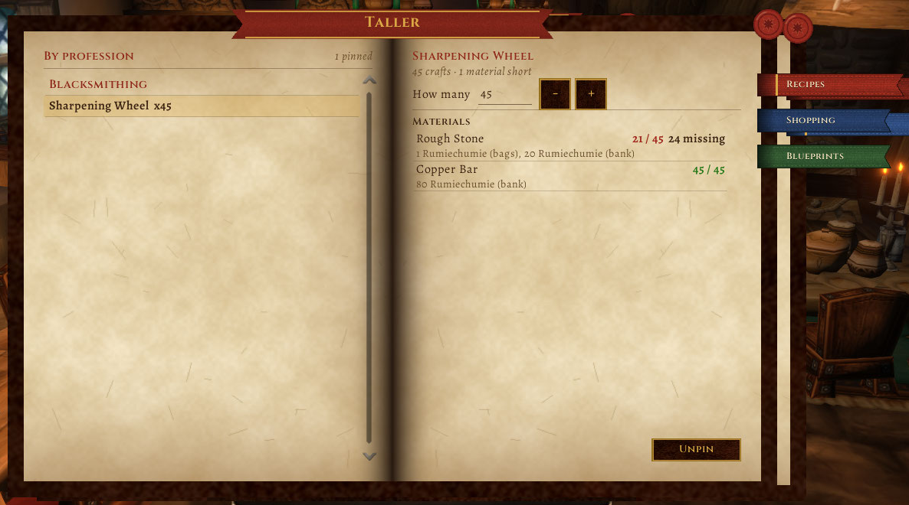

# Taller

For crafters in **WoW Forever**. Pin recipes, say how many you want to make, and Taller tells you how many materials you need and how many you have: in your bags, your bank and your other characters. All split by profession. ("Taller" is Spanish for workshop.)

[Leer en castellano](README.md)

It opens with `/taller`, with the **round minimap button** (right click: the blueprints; drag it around the minimap, `/taller minimapa off` hides it), with the key binding or from the addon compartment. The window is an **open book** (the [Pergamino](https://github.com/JoseArgento/pergamino) skin shared with Bitácora and the other addons): three cloth bookmarks, **Recipes**, **Shopping** and **Blueprints**; on each, the left page is the list and the right page the detail of what you picked.

- **Pin:** in the game's profession window, tick the box to track the recipe. It shows up in Taller. Untick it and it's unpinned; unpin it in Taller and it's unticked.
- **Recipes:** your pins by profession on the left; pick one and its materials are on the right with "have / need", what is missing and where you keep them ("5 Josecito (bags), 12 Ana (bank), 3 account bank"), plus the quantity, `+` and `-` (Shift for 10) and "Unpin". It counts **items**: if a recipe makes 5 stones per craft and you want 12, that's 3 crafts.
- **Shopping list:** everything your recipes need, added up, most missing first (priced with Auctionator when you have it). If another recipe of yours makes a material, it says so. On the right, the same as one line of text to copy into a whisper.
- **When you craft** the quantity goes down by itself; at zero you get a message and it's unpinned.
- **Item tooltips:** "Taller: 20 needed, 3 here, 12 on Ana".
- **Camping blueprints:** the Blueprints bookmark lists the professions folded, with "learned / total" on each; open one and its blueprints are there. Pick one and the right page says which of your characters learned it, who carries it unlearned, who drops it and what it builds (beta data; 10 sources not known yet). Blueprint tooltips say whether any of your characters learned it.
- `/taller` opens the book, `/taller planos` (or `blueprints`) the blueprints, `/taller copiar` (or `copy`) gives what is missing as text, `/taller compras` (or `shopping`) goes to the shopping list.
- **Language:** Spanish on a Spanish client. On an English client, `/taller idioma es` (or `language es`) switches it to Spanish anyway; `en` forces English, `auto` follows the game again.

**What it counts:** bags (and the reagent bag) always; your bank and the account bank as you last saw them; other characters as of your last login with them. Not the mailbox or the auction house.

**Plays well with Syndicator, Baganator and Auctionator** (none required): with **Syndicator** (also bundled in **Baganator**) your other characters, the guild bank and the account bank are counted from its data, which covers characters Taller never saw, mail included; your own bags and bank stay live from Taller. The material's tooltip says "via Syndicator" when that is where a count came from. With **Auctionator**, the shopping list prices each missing material (`~1g 85s 10c`) and shows the total; "Copy list" includes them. When either is missing or its API differs, nothing is shown and Taller works as before. ⏳ Their API names are from memory (their sources could not be fetched when this was written): see `Taller/Partners.lua`; every call is guarded, and it is untested with both installed.

**Why another one:** *Forever Profession Master* has a queue with quantities but only counts bags; *ItemWatch & Shopping List* counts bags and bank but not alts; *ForeverArtisan* counts alts with an extra bag addon. Taller does one thing: what you want to craft against everything you own, on every character, with nothing else needed.

**Tested**: every API checked against Forever 1.60.1 (`tools/check_api.py`); forever-lint and Addon Sentry report nothing; 48 tests in Lua 5.1 with several characters sharing the saved data and stand-ins for Syndicator and Auctionator. **In the client** (since launch): the book, pinning from the profession window, material counts across bags and bank, the shopping list, the folded blueprints and the minimap button. **Not seen yet**: that `UNIT_SPELLCAST_SUCCEEDED` carries the recipe ID when crafting (so the count goes down by itself), Forever's account bank, which boss drops the 10 missing blueprints, and the real Syndicator and Auctionator APIs.

**If something breaks:** `/taller errores` shows the addon's last error (the last 10 are kept, no popups) to copy into a GitHub issue. The "Errors" bookmark only shows while there is something kept.

## Support

All of this is free and open source, and it stays that way: no paid features, nothing early for supporters. If it helped you and you want to cover the time it takes to keep it working (every Blizzard patch means refreshing the data and fixing what broke), you can do that on [Patreon](https://www.patreon.com/cw/DoblePupi). Thanks ♥

Not affiliated with Blizzard Entertainment. MIT license.
