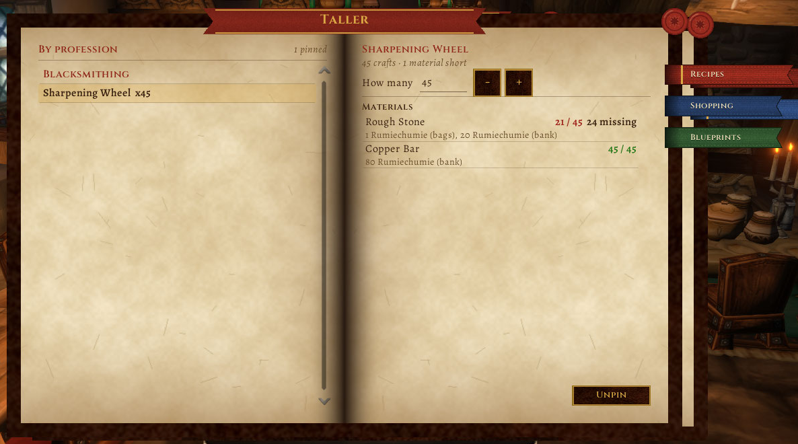

# Taller

Para los que craftean en **WoW Forever**. Pineás recetas, ponés cuántas querés hacer, y Taller te dice cuántos materiales necesitás y cuántos tenés: en las bolsas, en el banco y en tus otros personajes. Todo dividido por profesión.

[Read in English](README.en.md)



**Contenido**

- [Cómo se usa](#cómo-se-usa)
- [Qué cuenta](#qué-cuenta)
- [Instalar](#instalar)
- [¿Por qué otro más?](#por-qué-otro-más)
- [Cómo se probó](#cómo-se-probó)
- [Desarrollo](#desarrollo)
- [Apoyar](#apoyar)

## Cómo se usa

Se abre con `/taller`, con el **botón redondo del minimapa** (clic derecho: los planos; se arrastra alrededor del minimapa y `/taller minimapa off` lo esconde), con el atajo de teclado o desde el compartimento de addons. La ventana es un **libro abierto** (la piel [Pergamino](https://github.com/JoseArgento/pergamino), la misma de Bitácora y los demás addons): tres marcadores de tela en el borde, **Recetas**, **Compras** y **Planos**. En cada uno, la página de la izquierda es la lista y la de la derecha, el detalle de lo que elegiste.

- **Pinear:** en la ventana de profesiones del juego, tildá la casilla para seguir la receta. Aparece sola en Taller. Si la destildás, se despinea; si la despineás en Taller, se destilda.
- **Recetas:** a la izquierda, tus recetas pineadas por profesión; elegís una y a la derecha están sus materiales con "tenés / necesitás", cuántos faltan y dónde los tenés ("5 Josecito (bolsas), 12 Ana (banco), 3 banco de cuenta"), más la cantidad, `+` y `-` (con Shift, de a 10) y "Despinear". La cantidad es de **objetos**: si una receta da 5 piedras por elaboración y querés 12, cuenta 3 elaboraciones. La cantidad se aplica con Enter o al salir del campo.
- **Compras:** a la izquierda, todo lo que piden tus recetas sumado, con lo que más falta arriba (y el precio, si tenés Auctionator). Si un material lo hace otra receta tuya (el paño para la camisa), te lo marca. A la derecha, lo mismo como una línea de texto para copiar y pasar por susurro.
- **Al craftear** baja la cantidad sola. Cuando llega a cero, te avisa y la saca.
- **En el tooltip** de un material: "Taller: necesitás 20, tenés 3 acá y 12 en Ana".
- **Planos de campamento:** el marcador "Planos" lista las profesiones, plegadas, con "aprendidos / total" en cada una; abrís una y están sus planos (nombre y nivel, con un sello "aprendido", "en bolsas" o "falta"). Elegís uno y a la derecha dice quién de tus personajes lo aprendió, quién lo tiene guardado sin aprender, qué jefe lo tira y qué arma. En el tooltip de un plano también te dice si ya lo aprendió alguno. El juego no lleva esta cuenta. Los datos (qué jefe tira cada uno) salen de las guías de la beta; para 10 de los 21 todavía no se sabe ⏳.
- `/taller` abre el libro, `/taller compras` va directo a la lista de compras, `/taller planos` a los planos y `/taller copiar` te da lo que falta como texto ("15x Paño de lino, 4x Hilo grueso") para pasárselo a alguien de la guild.
- **Idioma:** sale en castellano si el cliente está en castellano. Si jugás con el cliente en inglés y lo querés en castellano igual, `/taller idioma es` (`en` lo fuerza en inglés, `auto` vuelve a seguir al juego).

Las recetas son de quien las sabe hacer: si pineás algo con tu alt herrero, lo ves desde cualquier personaje ("la hace Ana").

## Qué cuenta

- **Bolsas** (incluida la bolsa de reagentes): siempre, cada vez que cambian.
- **Banco:** lo que viste la última vez que lo abriste. Si nunca lo abriste con ese personaje, te lo dice.
- **Banco de cuenta:** igual, una sola vez para todos.
- **Otros personajes:** lo que tenían la última vez que entraste con ellos.
- **No cuenta** el correo ni lo que está en la subasta (salvo con Syndicator, ver abajo).

## Se lleva bien con Syndicator, Baganator y Auctionator

No necesita ninguno, pero si los tenés los aprovecha:

- **Syndicator** (viene también adentro de **Baganator**): cuenta lo que tienen tus otros personajes, el banco de la guild y el banco de cuenta según Syndicator, que ya sigue a todos tus personajes aunque Taller nunca los haya visto, y suma el correo. Tus propias bolsas y tu banco los sigue leyendo Taller en vivo. Cuando un dato viene de ahí, el tooltip del material lo dice ("vía Syndicator").
- **Auctionator**: en la lista de compras, cada material que falta muestra lo que costaría según los precios de Auctionator (`~1g 85s 10c`) y abajo el total. "Copiar lista" los incluye.

Si alguno de los dos no está, o cambió su API, Taller no muestra nada de eso y sigue como siempre. ⏳ Los nombres de sus funciones están tomados de memoria (no pude bajar el código de ninguno de los dos al escribir esto): están en `Taller/Partners.lua`, cada llamada va protegida, y falta probarlo con los dos instalados.

## Instalar

Copiá la carpeta `Taller` a `Interface\AddOns\`, dentro de la carpeta de Forever del juego. Entrá una vez con cada personaje (y abrí su banco) para que cuente lo que tiene.

## ¿Por qué otro más?

Ya hay addons de profesiones para Forever, y algunos están muy buenos. *Forever Profession Master* tiene cola con cantidades pero cuenta solo las bolsas. *ItemWatch & Shopping List* suma bolsas y banco pero no tus otros personajes. *ForeverArtisan* cuenta otros personajes si le sumás un addon de bolsas. Taller hace una sola cosa: lo que querés craftear contra todo lo que tenés, en todos tus personajes, sin depender de nada más.

## Cómo se probó

**Probado:**
- ✅ Cada función, evento, template y sonido existe en Forever 1.60.1: `tools/check_api.py` contra los dumps de [Ketho/BlizzardInterfaceResources](https://github.com/Ketho/BlizzardInterfaceResources) y la UI de [Gethe/wow-ui-source](https://github.com/Gethe/wow-ui-source), rama `forever`. Forever usa la API de profesiones moderna (`C_TradeSkillUI.GetRecipeSchematic`, `TRACKED_RECIPE_UPDATE`) y el banco por pestañas (`Enum.BagIndex.CharacterBankTab_*`, `AccountBankTab_*`).
- ✅ [forever-lint](https://github.com/JoseArgento/forever-lint) sin problemas; [Addon Sentry](https://github.com/JoseArgento/addon-sentry): "Sin señales de riesgo".
- ✅ **48 tests** en Lua 5.1 (el Lua de WoW), con varios personajes de la misma cuenta compartiendo los datos guardados, y con dobles de Syndicator y Auctionator (presentes, ausentes, tirando errores o devolviendo cualquier cosa).

**En el cliente** (desde el lanzamiento): el libro, pinear una receta desde la ventana de profesiones, la cuenta de materiales en bolsas y banco, la lista de compras, los planos plegados y el botón del minimapa.

**Todavía sin ver ⏳:**
- Que `UNIT_SPELLCAST_SUCCEEDED` traiga el ID de la receta al craftear, para que la cantidad baje sola (así es en retail).
- El banco de cuenta de Forever.
- Los planos: que la receta que enseña cada plano dé como resultado el objeto de campamento (así los reconoce), y qué jefe tira los 10 que faltan.
- Syndicator y Auctionator de verdad: los nombres de sus APIs y la forma de lo que devuelven.

## Desarrollo

```bash
pip install pytest lupa
pytest
python tools/check_api.py --bir ../BlizzardInterfaceResources --ui ../wow-ui-source --scanner ../addon-sentry/src
```

Un tag `v*` empaqueta el addon con el packager de BigWigs.

Sin relación con Blizzard Entertainment. World of Warcraft es marca registrada de Blizzard Entertainment, Inc. Licencia MIT.

Fuentes de los planos: [mmonster.co](https://mmonster.co/wow-forever/guides/professions/camping) · [wow-professions.com](https://www.wow-professions.com/forever/camping-guide) (datos de la beta).

## Apoyar

Todo esto es gratis y de código abierto, y va a seguir así: no hay funciones pagas ni nada antes para quien aporta. Si te sirvió y querés bancar el tiempo de mantenerlo (con cada parche de Blizzard hay que actualizar los datos y arreglar lo que se rompe), podés hacerlo en [Patreon](https://www.patreon.com/cw/DoblePupi). Gracias ♥
